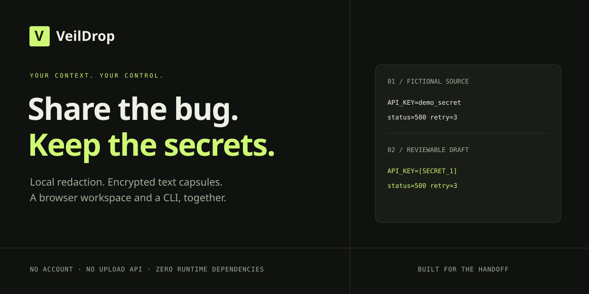

<div align="center">

# VeilDrop
### Share the bug. Keep the secrets.

**A local workspace for redacting developer text and making encrypted handoffs.**

No account · No upload API · No telemetry · Zero runtime dependencies

[Start in 30 seconds](#quick-start) · [CLI](#command-line) · [Security](SECURITY.md) · [Contribute](CONTRIBUTING.md)



</div>

You need help with a production bug. Your logs contain an API key, a database password, and customer emails. VeilDrop helps you remove recognizable secrets **before** you paste the logs into an issue, chat, or AI prompt. For a private handoff, turn the reviewed draft into a password-encrypted `.veil` file.

**Redaction is a heuristic, not a guarantee.** Review every draft before sharing. This initial release has automated tests but has not undergone an independent security audit.

## Quick start

Requires **Node.js 22 or later**. No `npm install`, API key, or build step is required.

1. Download this repository and extract it.
2. Open a terminal in the extracted `veildrop` folder.
3. Run:

```sh
npm start
```

Open **http://127.0.0.1:4317**, then choose **Load example**. The example is fictional.

On Windows: open the folder in File Explorer, type `powershell` into the address bar, and press Enter. If PowerShell blocks `npm.ps1`, use `node src/server.js` instead.

To stop the server, press **Ctrl+C**. To run tests: `node --test` or `npm test`.

## The handoff

1. **Paste or import** UTF-8 text: logs, configuration snippets, notes, prompts.
2. **Review the draft.** Repeated values get the same placeholder within that operation, preserving useful relationships.
3. **Add custom secrets** that the patterns missed, one exact value per line.
4. **Copy or download** the draft, or generate a passphrase and export an encrypted capsule.
5. The recipient runs VeilDrop, selects **Open a capsule**, and enters the passphrase. Send that passphrase through a separate channel.

Nothing automatically gets posted anywhere. Files are processed in browser memory; the local Node server only serves the application code. There is no content-upload endpoint, browser storage, third-party font, analytics script, or remote CDN. The application works without an internet connection after obtaining the repository and Node.js.

## What it catches

| Pattern | Example result |
| --- | --- |
| API-key, password, secret and selected token assignments | `API_KEY=[SECRET_1]` |
| GitHub, AWS access-key IDs, Stripe and Slack token formats | `[GITHUB_TOKEN_1]` |
| PEM private-key blocks | `[PRIVATE_KEY_1]` |
| Bearer credentials and JWT-shaped strings | `Bearer [BEARER_TOKEN_1]` |
| User information in URLs | `postgres://[URL_CREDENTIALS_1]@db.internal/app` |
| Email and IPv4 addresses, optional | `[EMAIL_1]`, `[IP_ADDRESS_1]` |
| Your exact custom values | `[CUSTOM_1]` |

It does **not** understand all languages, encoded secrets, arbitrary personal data, IPv6 addresses, phone numbers, multiline configuration syntax, or every provider's token format. Short/unfamiliar tokens can be missed; harmless text can match. It redacts text rather than parsing its format, so output is intended for human-readable debugging, not as executable configuration. Reports contain categories and positions, never a secret-to-placeholder lookup table.

## Command line

The CLI uses the same redaction and encryption code as the browser.

```sh
# Redact a log; refuse to overwrite any existing output file.
node src/cli.js redact incident.log reviewed.txt

# Keep email and IPv4 addresses, but still redact credential patterns.
node src/cli.js redact incident.log reviewed.txt --no-personal

# Apply extra exact-match rules from a private JSON array file.
node src/cli.js redact incident.log reviewed.txt --literals private-rules.json

# Encrypt a reviewed file. A passphrase file contains one long passphrase.
node src/cli.js seal reviewed.txt handoff.veil --passphrase-file private-passphrase.txt

# Decrypt. An incorrect passphrase creates no output file.
node src/cli.js open handoff.veil restored.txt --passphrase-file private-passphrase.txt
```

Use `-` for standard input or output. Diagnostics go to stderr. For example:

```sh
node src/cli.js redact - - < incident.log
```

**CLI `seal` encrypts the exact input; it does not automatically redact it.** Browser encryption uses the redacted draft. Passphrases never go in command arguments. Protect passphrase files with OS permissions, keep them outside the repository, and delete them when appropriate. POSIX output files are created with mode `0600`; Windows relies on directory ACLs. Commands never overwrite existing output files.

Limits: 1 MiB of UTF-8 source text; 1,500,000 bytes per capsule; 100 custom values of 3–1024 characters. Custom matching is case-sensitive. Leading/trailing spaces in custom values are meaningful.

## Encryption, without magic

- AES-256-GCM through standard Web Crypto, with a 128-bit authentication tag.
- PBKDF2-HMAC-SHA-256 with 600,000 iterations and a new random 128-bit salt per capsule.
- A new random 96-bit IV per encryption, and an authenticated format identifier.
- Generated passphrases use 192 bits from the platform cryptographic RNG.
- Strict version, KDF, field, encoding, and size validation before decryption.

These parameters do not rescue a guessable password. Prefer **Generate** or a unique, strong passphrase. The 16-character minimum is an input guard, not a strength guarantee. PBKDF2 was chosen for browser/Node interoperability without bundled crypto dependencies; it is not memory-hard. See [the threat model](SECURITY.md) and [the capsule format](docs/CAPSULE_FORMAT.md).

A capsule has no expiry, revocation, recovery, or one-time-read property. Anyone with a copy and the passphrase can decrypt it. Encryption authenticates the capsule contents, not the identity of its sender.

## Small enough to inspect

```text
src/core.js       Detection, overlap handling, stable replacement labels
src/crypto.js     Shared authenticated encryption and capsule parsing
src/cli.js        Bounded input, safe file creation, shell integration
src/server.js     Loopback-only static allowlist server
web/             HTML, CSS, and browser application
test/           Node redaction, encryption, CLI, and server tests
scripts/         Optional real-browser integration checks
```

JavaScript handles the behavior in Node and the browser, HTML provides semantic UI, and CSS provides the responsive workspace. No transpiler or framework is needed.

## Development

```sh
npm test
npm run check
```

Optional browser tests require Playwright **for development only**:

```sh
npm install --no-save --package-lock=false playwright
npx playwright install chromium
npm run test:browser
```

The browser test starts and stops its own loopback server. It checks browser↔CLI capsule compatibility, clipboard copying, wrong-password handling, responsive layout, inert HTML input, session clearing, and absence of external network requests. To capture an actual app screenshot on POSIX:

```sh
VEILDROP_SCREENSHOT=docs/workspace.png npm run test:browser
```

The repository includes a GitHub Actions matrix for Node 22/24 on Windows/Linux. The shipped validation record is in [docs/VALIDATION.md](docs/VALIDATION.md); a configured CI workflow is not evidence that every platform has already been tested.

## Make it better

Useful contributions: synthetic detector fixtures, false-positive reductions, accessibility improvements, and independent security review. Read [CONTRIBUTING.md](CONTRIBUTING.md). Never submit real credentials in an issue or pull request.

Built by **Okan Tiktas**. MIT licensed. If it makes a handoff easier, a star or a synthetic edge-case report helps.
